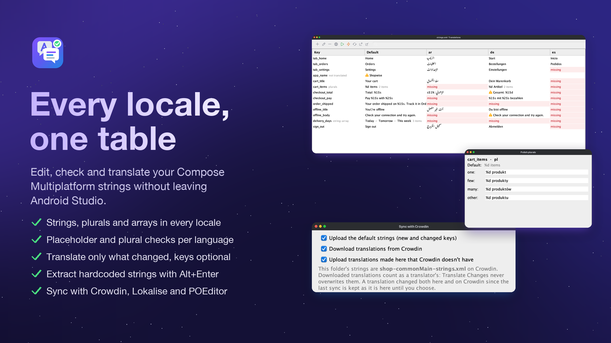
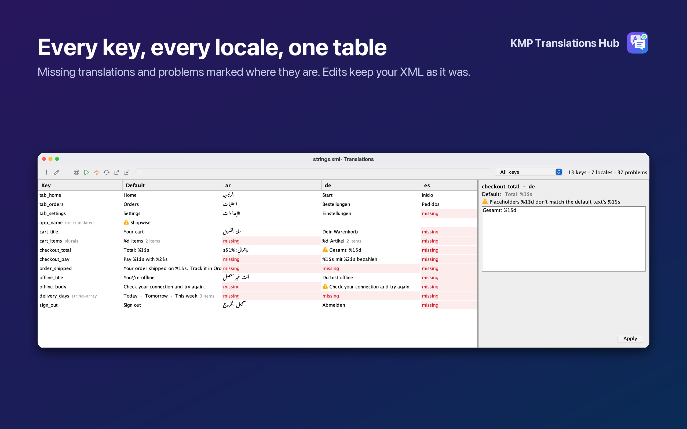
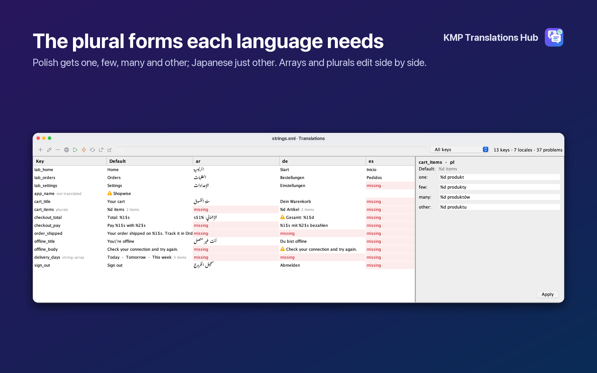
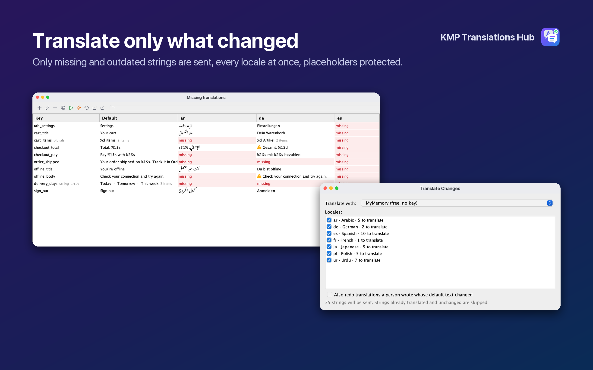
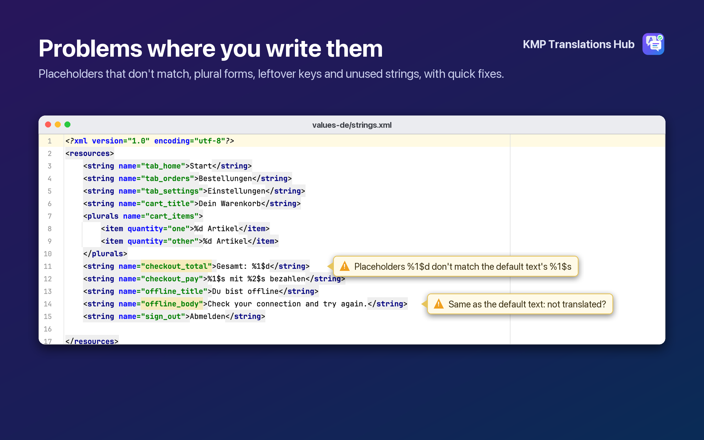
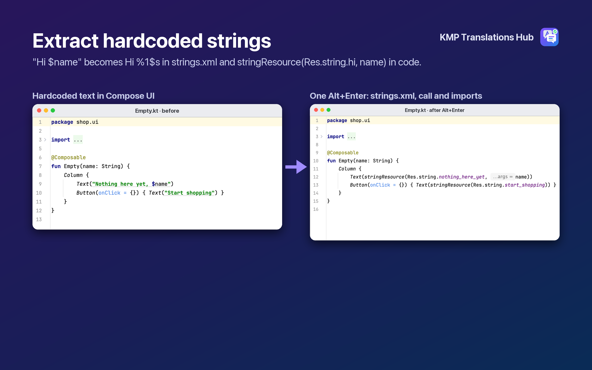
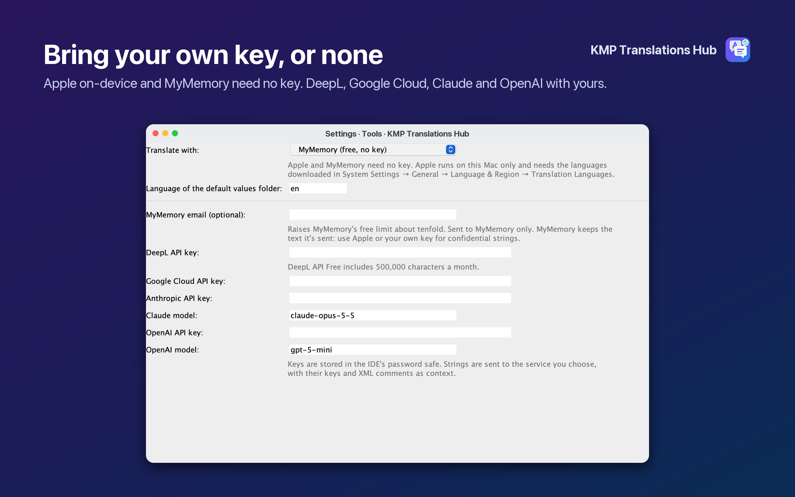
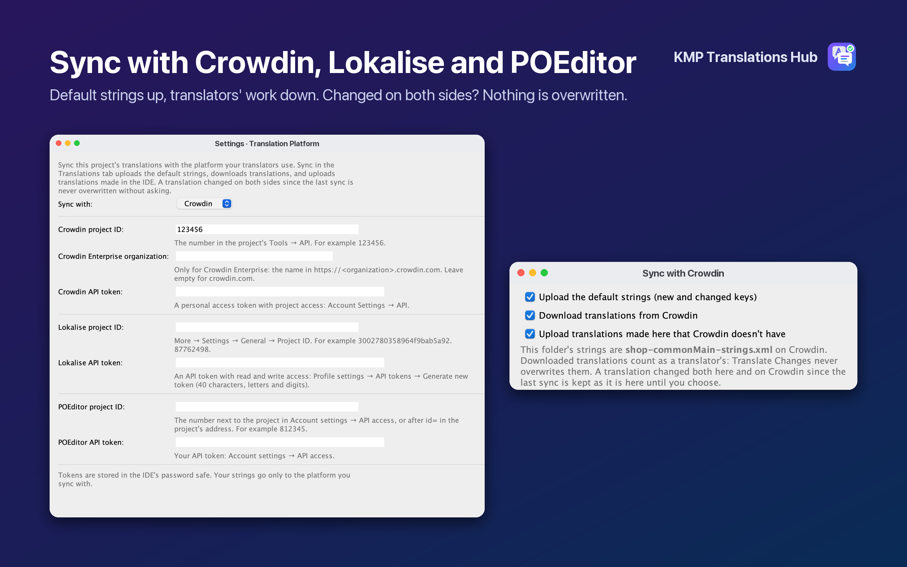

<div align="center">



# KMP Translations Hub

**Every locale of your Compose Multiplatform app in one table, and only what changed gets translated.**

For Kotlin Multiplatform and Compose Multiplatform developers who keep their strings in `composeResources`.

<a href="https://plugins.jetbrains.com/plugin/35376-kmp-translations-hub"></a>

[](https://plugins.jetbrains.com/plugin/35376-kmp-translations-hub)
[](https://plugins.jetbrains.com/plugin/35376-kmp-translations-hub)
[](https://plugins.jetbrains.com/plugin/35376-kmp-translations-hub/reviews)


<a href="https://youtu.be/OsYgv6vD9V4"></a>

▶ [Watch the 90-second demo](https://youtu.be/OsYgv6vD9V4)

</div>

## Install

In Android Studio or IntelliJ IDEA (2025.1 or newer): **Settings → Plugins → Marketplace**, search for
**KMP Translations Hub** and install it, or use the button above:
[plugins.jetbrains.com/plugin/35376-kmp-translations-hub](https://plugins.jetbrains.com/plugin/35376-kmp-translations-hub).

Then open any `composeResources/values…/strings.xml` and switch to the **Translations** tab at the bottom of the editor.

<details>
<summary>Build it from source instead</summary>

```bash
./gradlew :idea-plugin:buildPlugin
```

**Settings → Plugins → ⚙ → Install Plugin from Disk…**, pick
`idea-plugin/build/distributions/kmp-translations-hub-<version>.zip`, and restart.

</details>

## Features

### Every key, every locale, one table

The **Translations** tab shows every key of the module against every locale: strings, plurals and string-arrays.
Missing translations and problems are marked in place; search, or filter to missing, problem or outdated keys. Edit a
cell and only that tag changes in the XML: comments, order and formatting stay as they were, and each edit is one Undo,
from the tab or the file. Add, rename and delete keys in every locale at once, and add any number of locales in one go: tick them, pick the
top 10, or type tags such as `sr-Latn, es-MX`.



### The plural forms each language needs

The side panel edits plurals and arrays. Each locale gets a field for every plural form its language uses: Polish one,
few, many and other; Arabic six; Japanese just other. Forms a language needs but doesn't have are flagged.



### Translate only what changed

**Translate Changes** sends only what's missing or outdated, every locale at once, and skips everything already
translated and unchanged. Placeholders (`%1$s`, `%d`), inline markup and escapes are protected; a result that loses a
placeholder is dropped instead of saved. Translations a person wrote are never overwritten: when their default text
changes, they're flagged for review. See [how it works](#how-translating-only-what-changed-works).



### Problems where you write them

The same checks run in the XML editor: placeholders that don't match the default text, plural forms, arrays with the
wrong number of items, keys left behind in a locale, text identical to the default, unknown escapes, translations far
longer than the default, and keys no Kotlin code uses. Quick fixes add the missing plural forms or delete the leftover
key. ⌘/Ctrl+click `Res.string.hello` in Kotlin to jump to its XML; a gutter icon on each key finds its uses.



### Extract hardcoded strings

Alt+Enter on text in Compose UI code moves it to the module's `strings.xml` and replaces it with
`stringResource(Res.string.…)`, with string templates turned into placeholders and the imports added: one Undo
reverts both files. **Code → Inspect Code** finds every hardcoded string in the project to extract them all.



### Bring your own key, or none

| Service | Key | Notes |
|---|---|---|
| Apple on-device | None | macOS 26+. Offline; nothing leaves the Mac. Download the languages first in System Settings → General → Language & Region → Translation Languages. No Urdu. |
| MyMemory | None | About 5,000 characters a day per IP, ~10× with an optional email. One string per request: right for a few new strings. |
| DeepL | Yours | The free plan includes 500,000 characters a month. |
| Google Cloud Translation | Yours | v2 API with an API key. |
| Claude | Yours | Anthropic's official SDK; model in Settings (default `claude-opus-5-5`). Answers are schema-checked JSON. |
| OpenAI | Yours | Model in Settings (default `gpt-5-mini`). |

Keys are kept in the IDE's password safe. **Settings → Tools → KMP Translations Hub.**



### Sync with Crowdin, Lokalise and POEditor

**Sync with Translation Platform** in the Translations tab works with the platform your translators already use. It
uploads the default strings (new and changed keys), downloads your translators' work into `composeResources`, and
uploads translations made in the IDE that the platform doesn't have yet. Plurals and arrays go both ways as Android
`strings.xml`, which all three read and write.

Nothing is overwritten silently. `translations.lock.json` remembers what each translation was at the last sync, so:

| Since the last sync | What Sync does |
|---|---|
| Changed on the platform | Downloads it. It counts as a translator's, so Translate Changes never replaces it |
| Changed in the IDE | Keeps it, and uploads it |
| Changed on both sides | Keeps yours and asks: the platform's, or yours (uploaded next time) |

Set the platform, project ID and token in **Settings → Tools → KMP Translations Hub → Translation Platform**. Each
`composeResources` folder is one file on the platform, named after its module and source set
(`composeApp-commonMain-strings.xml`). On POEditor, which has one set of keys per project, use one project per folder
when modules share key names.



### Import, export and Run in this locale

Export CSV (all locales), XLIFF 1.2 or Android `strings.xml` for translators, and import them back: plural forms and
array items are their own entries (`cart_items#few`, `days[2]`), so any tool can handle them. With
[KMP Device Hub](https://plugins.jetbrains.com/plugin/35272-kmp-device-hub) installed, **Run App in Selected Locale**
relaunches your app in that column's language on an Android device or iOS simulator.

## Free and Pro

**Early access:** every Pro feature is free in the current release, while the paid plan is set up on the
Marketplace. Ratings and reviews on the [Marketplace page](https://plugins.jetbrains.com/plugin/35376-kmp-translations-hub/reviews) help a lot.

| Free | Pro (free trial through JetBrains Marketplace) |
|---|---|
| The Translations tab: strings, plurals, arrays, every locale | Translate Changes with Apple, MyMemory, DeepL, Google Cloud, Claude or OpenAI |
| Add, rename and delete keys; add locales | Plural forms per language, in the side panel and the checks |
| Missing translations, placeholders, array sizes, keys left behind | Unknown escapes, untranslated text, length, unused keys |
| `Res.string` navigation and usages | Extract hardcoded strings |
| | Sync with Crowdin, Lokalise and POEditor |
| | Import and export: CSV, XLIFF, `strings.xml` |
| | Run in this locale, with KMP Device Hub |

## How translating only what changed works

`translations.lock.json` sits next to each `composeResources` folder (outside what the resource compiler reads) and
is committed with it. For each translation it stores a hash of the default text it was made from, a hash of its own
text, and who wrote it (`deepl`, `apple`, `mymemory`, `claude`… or `human`):

| State | What Translate Changes does |
|---|---|
| Missing | Translates it |
| Default text changed, machine translation | Translates it again |
| Default text changed, written by a person | Flags it for review; never overwrites it |
| Unchanged | Skips it: no request |

A machine translation someone edited by hand counts as `human` from then on. The file is created the first time
something is machine translated, and the translations already there are recorded as `human` and current, so the
first run doesn't re-translate the app. Projects that never machine-translate get no extra file.

## Privacy

No analytics or telemetry, and no servers of its own. Strings go only to the translation service you pick, when you
run Translate Changes; Apple translation stays on the Mac, and API keys stay in the IDE's password safe. MyMemory's
terms say it keeps the text it's sent, so use Apple or your own key for confidential strings. The full policy, with
what each service receives: [PRIVACY.md](PRIVACY.md).

## Development

| Module | What it is |
|---|---|
| `core` | Dependency-free engine: `values-…` qualifiers, the `strings.xml` model and parser, plural rules per language, checks, `translations.lock.json`, import/export formats and translation plans. No IDE APIs, so a CLI or CI check can reuse it. |
| `idea-plugin` | The Translations tab, PSI writer (keeps formatting, one Undo per edit), inspections and quick fixes, `Res.string` navigation, string extraction (Kotlin PSI), translation services, Pro licensing. |
| `tools/apple-translate` | `translationshub-apple`, the Swift helper for Apple's Translation framework. `./build.sh` rebuilds the universal binary into the plugin's resources (needs Xcode with the macOS 26 SDK). |
| `tools/listing` | The README and Marketplace images. See below. |

```bash
./gradlew test                       # core + IDE tests
./gradlew :idea-plugin:runIde -Ptranslationshub.openProject=/path/to/cmp/project
./gradlew :idea-plugin:verifyPluginStructure :idea-plugin:verifyPlugin  # plugin.xml, then the IDE in local.properties
./gradlew :idea-plugin:verifyPlugin -Ptranslationshub.verifyIdes=IU:2025.1.7.2,IU:2025.2.6.3,IU:2025.3.6.1  # like Marketplace
```

Set the IDE to build against in the git-ignored `local.properties`:
`translationshub.ideaLocalPath=/Applications/Android Studio.app`.
`./gradlew :core:test -Ptranslationshub.realProject=/path/to/cmp/project` also reads a real project and prints what it
found in each `composeResources` folder.

**Images.** The screenshots and banner are made from the plugin's real panels, rendered by a test with a fictional
shop app:

```bash
./gradlew :idea-plugin:test --tests '*ListingRender*'
python3 tools/listing/make_listing.py idea-plugin/build/listing docs
```

**Performance** (2,000 keys × 15 locales): the engine reads them in 30 ms and checks in 89 ms; the Translations tab
opens in 151 ms, and an edit with re-read takes 279 ms.

Release steps are in [RELEASE.md](RELEASE.md).
